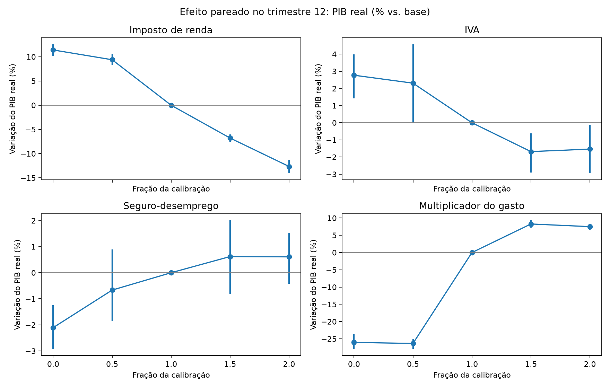
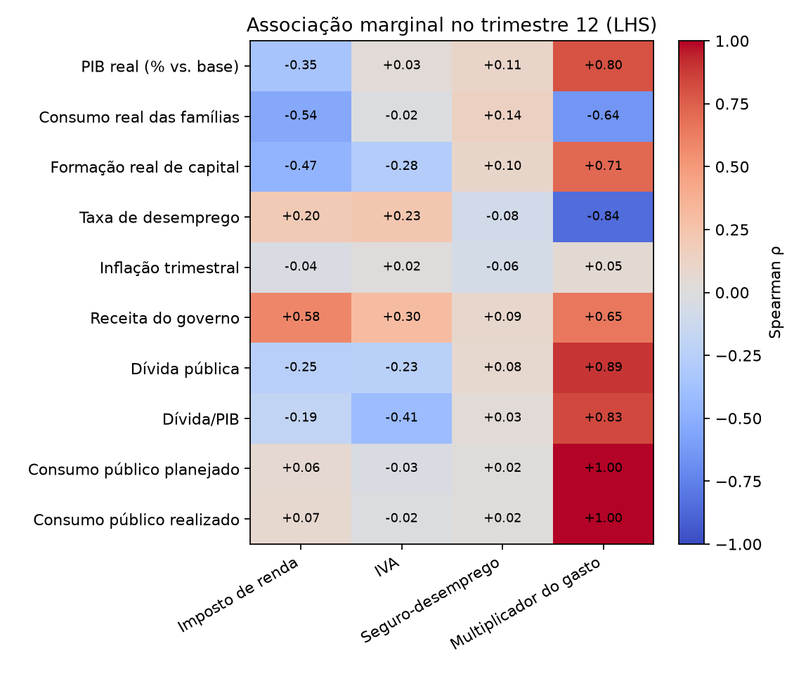

# AdaptGov: resumo do plano de pesquisa

O projeto propõe investigar se uma política fiscal adaptativa, treinada por aprendizagem por reforço, proporciona maior bem-estar que políticas de parâmetros fixos no modelo macroeconômico baseado em agentes BeforeIT.jl, calibrado para a Áustria. A pesquisa parte da perspectiva da economia complexa, na qual indicadores agregados, como inflação, crescimento e desemprego, emergem das interações entre agentes heterogêneos. O objetivo é avaliar os efeitos da adaptação da política sobre o desempenho econômico, a dívida pública e a estabilidade macroeconômica.

As simulações descrevem a evolução do estado do modelo $x_t$ em função dos parâmetros $\theta$ e de choques aleatórios $\varepsilon_{t+1}$; os resultados observáveis são representados por $y_t$:

$$
x_{t+1}=F(x_t,\theta,\varepsilon_{t+1}),\qquad y_t=g(x_t).
$$

O agente governamental observará o PIB real $Y_t^{\mathrm{real}}$, o desemprego $u_t$, a inflação $\pi_t$, a razão déficit/PIB $d_t$ e a razão dívida/PIB $b_t$. A partir dessas observações, escolherá ajustes nas alíquotas do imposto de renda e do IVA, no parâmetro do seguro-desemprego e no multiplicador da demanda de consumo do governo:

$$
\begin{aligned}
s_t&=(Y_t^{\mathrm{real}},u_t,\pi_t,d_t,b_t),\\
p_t&=(\tau_t^{\mathrm{INC}},\tau_t^{\mathrm{VAT}},\theta_t^{\mathrm{UB}},\log m_t^G),
\qquad p_{t+1}=p_t+a_t.
\end{aligned}
$$

A recompensa por trimestre combina o aumento do PIB real, a redução do desemprego, a convergência à meta de inflação $\pi^*$ e penalidades para desvios das referências fiscais. O déficit de 3% do PIB e a trajetória da dívida em direção a 60% do PIB são referências inspiradas nas regras europeias:

$$
\begin{aligned}
r_t={}&\alpha\log\!\left(\frac{Y_t^{\mathrm{real}}}{Y_0^{\mathrm{real}}}\right)
-\beta u_t-\gamma|\pi_t-\pi^*|\\
&-\lambda_d[\max(0,d_t-0{,}03)]^2
-\lambda_b[\max(0,b_t-b_t^{\mathrm{meta}})]^2,\\
b_t^{\mathrm{meta}}={}&0{,}60+\max(0,b_0-0{,}60)\left(\frac{19}{20}\right)^{t/4}.
\end{aligned}
$$

O agente será treinado por Q-learning, com ações exploratórias selecionadas por uma política $\varepsilon$-greedy. A função de valor será atualizada pela equação de Bellman:

$$
Q(s_t,a_t)\leftarrow(1-\alpha)Q(s_t,a_t)
+\alpha\left[r_t+\gamma\max_{a\in\mathcal A}Q(s_{t+1},a)\right].
$$

Nesta equação, $\alpha$ é a taxa de aprendizado e $\gamma$ é o fator de desconto; na recompensa, os mesmos símbolos designam pesos dos indicadores.

Antes do treinamento, a análise de sensibilidade examina os efeitos dos parâmetros fiscais. São selecionadas $N$ configurações por amostragem por hipercubo latino; cada uma permanece fixa durante 12 trimestres e é avaliada com $J$ sementes aleatórias comuns:

$$
\{p_i\}_{i=1}^{N}=\mathrm{LHS}(\mathcal P,N),\qquad
\bar{\mathbf y}_{i,12}=\frac{1}{J}\sum_{j=1}^{J}S_{12}(p_i,\mathbf x_0,\varepsilon_j).
$$

## Resultados preliminares da análise de sensibilidade

Na escala de 1:1000, os parâmetros fiscais variam de 0% a 200% dos valores calibrados para a Áustria; os gráficos mostram a variação percentual do PIB real em relação à base e as associações entre parâmetros e indicadores no 12º trimestre.

*Efeito pareado sobre o PIB real: cada parâmetro varia isoladamente, com barras de incerteza.*

*Sensibilidade global: correlações de Spearman na amostragem por hipercubo latino.*

### Pontos para comentar nos resultados

- Destaque a resposta não linear do PIB ao multiplicador do gasto, sobretudo entre 50% e 100% da calibração.
- Relacione a associação positiva do multiplicador do gasto com o PIB à sua associação positiva com a dívida pública.
- Comente que o aumento do imposto de renda reduz o PIB no experimento pareado, enquanto sua redução o eleva.
- Aponte que os efeitos do IVA e do seguro-desemprego sobre o PIB são menores e apresentam maior incerteza.
- Explique que o gráfico pareado compara alterações isoladas, enquanto as correlações do hipercubo latino mostram associações sob variação conjunta dos parâmetros.
- Delimite as conclusões à calibração austríaca, à escala de 1:1000 e ao horizonte de 12 trimestres.

Os resultados orientarão a definição dos pesos da recompensa e a comparação entre a política aprendida e políticas fixas, considerando cenários com e sem choques econômicos. Assim, o projeto busca identificar em quais condições a adaptação fiscal melhora os resultados das simulações e pode contribuir para a análise de políticas públicas.

Fonte: [Plano de pesquisa](./plano-de-pesquisa.pdf).
